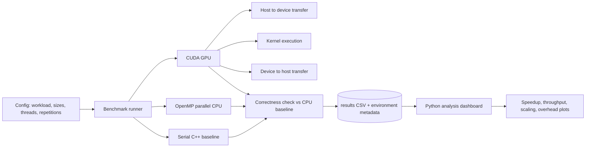

# Heterogeneous Computing Performance Lab

**When does GPU acceleration actually improve performance, and what causes the bottlenecks?**

A reproducible benchmarking framework that compares **serial C++**, **OpenMP-parallel CPU** and **CUDA GPU** implementations of core computational workloads, with kernel time measured separately from host-to-device data transfer time, and a Python dashboard for analysing speedup, throughput and scaling.

    

> **Project status:** in progress. The roadmap below shows what is complete. All benchmark numbers in this repository come from real runs on the hardware listed in the results section. Nothing is estimated or simulated.

---

## Why this project

Moving work to a GPU is not automatically faster. Small inputs can be dominated by launch latency and PCIe transfers, memory-bound workloads can saturate bandwidth long before they saturate compute, and parallel CPU code can stop scaling because of overhead and memory contention. This project measures each of these effects directly instead of assuming them.

**Key questions**

1. At what input size does the GPU overtake the serial and OpenMP CPU versions?
2. How much of end-to-end GPU time is kernel execution versus data transfer?
3. How do memory-bound workloads (vector operations) differ from compute-bound workloads (matrix multiplication)?
4. Where does OpenMP thread scaling flatten, and why?
5. Which bottleneck dominates at each workload size: computation, memory access, synchronization or data movement?

---

## Architecture



---

## Workloads

| Workload | Character | Why it is included |
|---|---|---|
| Vector addition / SAXPY | Memory-bound | Shows when bandwidth and transfer cost dominate |
| Dot product / reduction | Synchronization-sensitive | Exposes reduction and parallel-overhead behaviour |
| Matrix multiplication (GEMM) | Compute-bound | Shows where GPU parallelism pays off |

Each workload is implemented in three variants: serial C++, OpenMP, and CUDA.

---

## Methodology

- **Configurable input sizes** and repetition counts; reported times are medians over repeated runs after warm-up.
- **CPU timing** with a high-resolution monotonic clock.
- **GPU timing** with CUDA events, with **host-to-device transfer, kernel execution and device-to-host transfer reported separately** as well as end-to-end.
- **Correctness tests:** every OpenMP and CUDA output is compared against the serial baseline within a floating-point tolerance before its timing is accepted.
- **Reproducibility:** each run records hardware, compiler, CUDA version and thread count alongside the results.
- **Metrics:** execution time, speedup over serial, throughput (GFLOP/s for compute workloads, GB/s for memory workloads), parallel efficiency and thread-scaling curves.

---

## Repository layout

```
heterogeneous-computing-lab/
├── src/
│   ├── cpu/            # serial C++ baselines
│   ├── openmp/         # OpenMP implementations
│   ├── cuda/           # CUDA kernels and host code
│   └── common/         # timing, validation, config parsing
├── tests/              # correctness tests (CPU vs OpenMP vs GPU)
├── analysis/           # Python dashboard and plotting scripts
├── results/            # raw CSV output with environment metadata
├── docs/               # technical report and figures
├── CMakeLists.txt
└── README.md
```

---

## Getting started

### Requirements

- C++17 compiler with OpenMP support (GCC or Clang)
- CMake 3.18 or newer
- Python 3.9+ with `pandas`, `numpy`, `matplotlib`
- *Optional for GPU runs:* NVIDIA GPU with a matching CUDA Toolkit. The CPU and OpenMP benchmarks run without a GPU.

### Build

```bash
git clone https://github.com/<your-username>/<repo-name>.git
cd <repo-name>
cmake -S . -B build -DCMAKE_BUILD_TYPE=Release
cmake --build build -j
```

### Run

```bash
# Example: matrix multiplication across sizes, 8 OpenMP threads, 10 repetitions
./build/bench --workload matmul --sizes 256,512,1024,2048 --threads 8 --reps 10 --out results/matmul.csv
```

### Test

```bash
ctest --test-dir build --output-on-failure
```

### Analyse

```bash
pip install -r analysis/requirements.txt
python analysis/dashboard.py --input results/ --out docs/figures/
```

---

## Roadmap

- [ ] Serial C++ baselines with input-size sweeps
- [ ] Correctness test suite
- [ ] OpenMP implementations with thread-scaling measurements
- [ ] CUDA kernels with separate kernel and transfer timing
- [ ] Python analysis dashboard
- [ ] Technical report on bottlenecks and limitations

**Planned extensions:** shared-memory tiled GEMM, pinned memory and CUDA streams for transfer overlap, roofline-style analysis, profiling with Nsight, and tensor-style operations for benchmarking AI workloads.

---

## Results

> Results will be added here from real runs only.

**Test hardware**

| Component | Details |
|---|---|
| CPU | _to be filled_ |
| GPU | _to be filled_ |
| Compiler / CUDA version | _to be filled_ |

**Summary of findings**

| Workload | Crossover size (GPU beats OpenMP) | Dominant bottleneck | Notes |
|---|---|---|---|
| Vector addition | _pending_ | _pending_ | _pending_ |
| Dot product | _pending_ | _pending_ | _pending_ |
| Matrix multiplication | _pending_ | _pending_ | _pending_ |

Figures (execution time, speedup, throughput, thread scaling, kernel-versus-transfer breakdown) will appear in `docs/figures/`.

---

## Limitations

- Results depend on the specific CPU, GPU, driver and compiler used, and should not be generalised to other hardware without re-running.
- Workloads are chosen to isolate behaviours and are not full application benchmarks.

---

## Author

**Gunika Sohal** · B.E. Electrical and Computer Engineering, Thapar Institute of Engineering and Technology

[GitHub](https://github.com/Gunika19) · [LinkedIn](https://www.linkedin.com/in/gunika-sohal-bb5935289)
